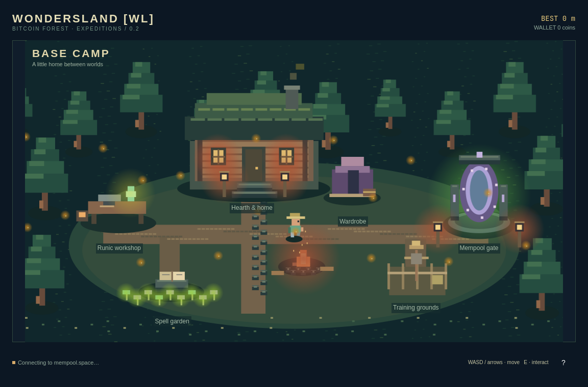

# WondersLand [WL]

[GitHub · WondrejGrower/WondersLand](https://github.com/WondrejGrower/WondersLand/tree/game/wondersland-0.2)

Samostatná pixelová běhačka v bitcoinovém lese. Spusť **WondersLand [WL]**
přes **Super + Space**.
Po spuštění se objeví Base Camp. Pohybuj se přes WASD / šipky nebo
kliknutím, u portálu či cvičiště stiskni E. Hra používá vlastní nativní Qt okno; nepotřebuje kiosk, Chromium ani běžící
službu Bitcoin Forest. Nemění playlist ani nastavení KioskChy.

| Ovládání | Akce |
| --- | --- |
| WASD / šipky / kliknutí v táboře | Pohyb |
| E v táboře | Interakce s blízkým stanovištěm |
| Mezerník / ↑ / kliknutí do krajiny | Skok; podržením vyskočíš výš |
| P / Escape | Pauza a pokračování |
| F11 | Celá obrazovka / okno |
| ? | Nápověda |
| Q | Ukončit |

Živé mince a rekord se uloží po konci běhu nebo při návratu do tábora.
Tréninkové mince a skóre se neukládají. Data jsou v
`~/.local/share/wondersland-game/progress.json`.
Dílna, šatník a zahrada kouzel představují místa pro další rozvoj; zatím se
v nich nic nekupuje. Mince jsou pouze herní body.
Obří duby a sekvoje mohou v této první verzi běh ukončit; upgrady zatím nejsou.
Po nárazu do živé transakce můžeš otevřít její skutečný záznam v mempool.space.
Trénink je označený a nikdy nevymýšlí blockchainové transakce.

Živé požadavky míří přímo na mempool.space: nedávné transakce každých
15 sekund a jednorázové ověření stavu po nárazu. Při výpadku lze použít
načtený zásobník nebo trénink. Nové transakce vstupují do dalšího běhu,
aktuální trať se během skoku nemění. Jde o výřez nedávných transakcí,
nikoliv celý mempool. Podrobné zadání a budoucí funkce: [PROJECT.md](docs/PROJECT.md).

Pro analýzu v ChatGPT: [mapa zdrojů a záměr hry](docs/AI_REVIEW.md).
Hra je ve větvi `game/wondersland-0.2`; `main` obsahuje původní samostatný web.

## Vývoj

Arch / Omarchy, GCC s C++17, Qt 6 base/declarative/wayland, qmake6, make.
Grafika je vlastní Canvas v QML, fyzika a data jsou v C++. Žádné npm závislosti.
Téma a jazyk následují Omarchy; přibalené jazyky jsou angličtina a čeština.

```sh
./bin/build
./bin/test
./build/wondersland-game open
./build/wondersland-game check --json
QT_QPA_PLATFORMTHEME= QT_QUICK_BACKEND=software ./build/wondersland-game preview docs/base-camp.png
./bin/install
```

Instalace sestaví Arch balíček přes makepkg. Odinstalace:
`sudo pacman -R wondersland-game`. Uživatelský rekord zůstává zachovaný.
Testy používají dočasné soubory a syntetické transakce, neprovádějí platby
ani změny kiosku. `preview` vytváří syntetický náhled bez sítě.

MIT · autor Wondrej. Theme / translation scaffolding převzatý z KioskChy,
Omarchy app templates, Omacut a Monologue: David Heinemeier Hansson (MIT).

Kontrola skutečného spojení s mempoolem bez otevření hry:
`./build/wondersland-game check --live --json`.
