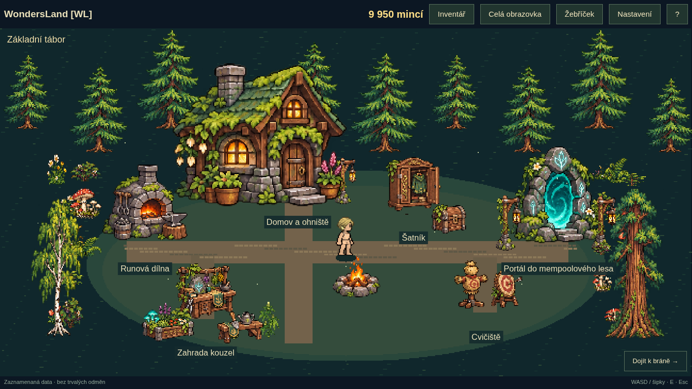

# WondersLand [WL] · 0.3.3

Nativní Qt/QML hra: dojdi k portálu, stiskni E, vyber schopnost a potvrď E.
Každý běh začíná od 0 m. Oblasti jednoho lesa se mění při 500, 1 500, 3 000
a 6 000 m; rozměry skutečných transakcí určuje jediná velikostní křivka.

Primární verzí je nyní **hra pro prohlížeč na wondersland.online**. Podle
nového výslovného zadání nahrazuje původní web; ten zůstává v archivní větvi.
Webový klient je v `web/`, původní nativní Qt/QML aplikace v `src/` funguje dál.
Sdílejí konfiguraci, překlady a pixelovou grafiku.

```sh
npm ci
npm test
npm run test:browser
npm run deploy:check
npm run dev
```

Cloudflare: [nasazení přes GitHub](docs/CLOUDFLARE_DEPLOYMENT.md).
[Webové náhledy, výsledky kontrol a ověřené nasazení](docs/BROWSER_VERIFICATION.md).
Postup z desktopu lze přenést v Nastavení → Importovat postup.

Větev: [game/roguelite-0.3](https://github.com/WondrejGrower/WondersLand/tree/game/roguelite-0.3).

| Kde | Ovládání |
| --- | --- |
| Všechny nabídky | WASD nebo šipky, E potvrdit, Esc zpět; funguje i myš |
| Zadávání jména | Písmena jsou text, Enter/Esc ukončí editaci; Tab také funguje |
| Tábor | WASD/šipky nebo kliknutí pro pohyb, E u stanoviště |
| Běh | Mezerník/W/↑/klik pro skok, podržení pro výšku; F pro získaný jetpack |
| Pauza a návrat | P/Esc pauza, B návrat do tábora |
| Nastavení, nápověda, celá obrazovka | F10, ?, F11 |

Při tvorbě postavy si vybereš Zahradníka, Průzkumníka nebo Sběratele.
Všechny role jsou dostupné od začátku; uloženou roli změníš pouze resetem
postavy a vytvořením nové. Cvičiště se otevře po prvním živém běhu,
další systémy postupně podle celkových živých metrů a nejlepšího běhu.
Statistiky jsou na Cvičišti, výroba v Runové dílně, vybavení a vzhled v Šatníku,
výzkum v Zahradě kouzel. Role se v táboře nemění.
Trénink a záznamy neposkytují trvalé odměny. Platby hra neobsahuje.

Nastavení obsahuje English / Čeština a přepíná celé rozhraní za běhu.
Jazyk přežije restart i reset postavy; nová instalace má angličtinu.

## Sestavení a kontroly

Arch/Omarchy: GCC s C++17, make, qmake6, qt6-base, qt6-declarative,
qt6-wayland; Python 3 pro analytické nástroje. Spouštěj z kořene projektu:

```sh
./bin/build
./bin/test
./build/wondersland-game open
./build/wondersland-game check --json
./build/wondersland-game check --live --json
./build/wondersland-game language cs
./bin/install
```

Aplikace se objeví pod WondersLand [WL] v launcheru Super+Space.
Data: `~/.local/share/wondersland-game/` (`progress.json`, `settings.json`,
`last-trace.json`). Migrace starého postupu vytvoří zálohu `.pre-v5` (u verze 3 také `.pre-v4`).

```sh
./build/wondersland-game preview /tmp/camp.png --camp --cs --size 1366x768
./build/wondersland-game preview /tmp/training.png --training --progress --cs
./build/wondersland-game preview /tmp/settings.png --settings --cs
python3 tools/record_mempool.py --help
python3 tools/analyze.py docs/live-recent-sample.json --seeds 50
```

[Popis změn a migrace](docs/JOURNEY_UPDATE.md) ·
[Ověření a náhledy](docs/JOURNEY_VERIFICATION.md) ·
[Konfigurace](src/balance.json).

Živý zdroj vrací jen nedávné transakce, nikoliv celý mempool. Velké transakce
mohou být nepřekonatelné; nevzniká povinně bezpečná cesta. Ekonomika a hranice
odemykání jsou pracovní návrh bez dlouhodobého lidského vyvážení. Tvrdý pád
může ztratit posledních několik sekund neuložených odměn.

## Postava a inventář

[Postava, startovní oblečení a inventář](docs/CHARACTER_INVENTORY_BRIEF.md) ·
[Grafické podklady a náhled nové sady](assets/art-source/2026-11-08/README.md).

Ve tvorbě postavy je 16 účesů a výběr základního oblečení. Inventář je od
začátku dostupný tlačítkem v táboře, podporuje nasazení/sundání a bezplatné
získání dalších základních kusů. Oblečení je kosmetické; původní diamantové
schopnosti a postup zůstávají zachované. Ukládání používá schéma 5.
Cvičiště u každého z pěti statů vysvětluje účinek česky i anglicky.

```sh
npm run test:inventory
node tools/build-character-sprites.mjs # pouze při změně PNG; vyžaduje ImageMagick 7
```

[Produkční vrstvy a jejich generování](assets/runtime/README.md).

## Botanický tábor a obratnost · 0.3.3

Tábor i les používají nové pixelarty. Konopí se vybírá pro částky v satoshi,
jejichž zápis začíná 420; TXID a rozměry transakce se tím nemění. Inventářové
oděvy sledují klouby a náklon postavy při pohybu.

Obratnost nově velmi mírně zpomaluje čas výpravy: 0,04 % za úroveň,
nejvýš 2 %. Skoky a překážky zpomalují společně. Tábor a výzkum zůstávají
běžným tempem; stávající koupené úrovně zůstávají zachované.

```sh
npm run test:environment
```

## Celá herní plocha a měsíční žebříček

Web nyní využívá celou dostupnou herní plochu i na mobilu; tlačítko Fullscreen
nebo F11 přepne do celoobrazovkového režimu. Měsíční komunitní žebříček sdílí
nejlepší běh, celkové metry a počet živých pokusů. Trénink a záznamy se nepočítají.
První transakce může stále být nepřekonatelná sekvoje — fronta se nefiltruje.
Běžné keře a kapradiny jsou dostupnější, vyšší stromy vyžadují Sílu.

[Mechaniky, ukládání, omezení a náhledy](docs/FULLSCREEN_MONTHLY.md).
Webové kontroly vyžadují Node.js 24+; přibylo `npm run test:monthly`.
