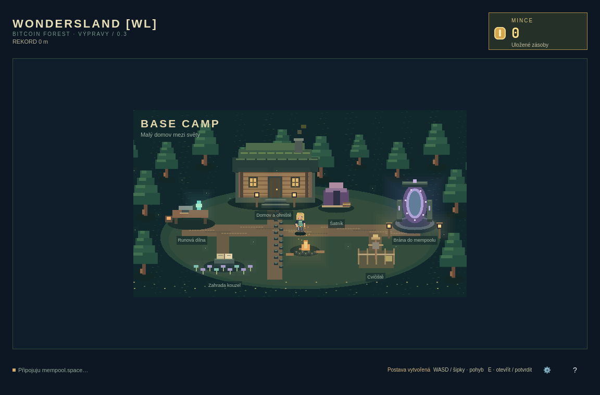

# WondersLand [WL] · 0.3

Nativní pixelová roguelite pro Linux/Omarchy. Vytvoř postavu, v táboře dojdi
k portálu, vyber tier a startovní skill a běž mezi rostlinami ze skutečných
bitcoinových transakcí. Největší stromy nemusí být překonatelné.
Po nárazu se dozvíš konkrétní TXID, přesný součet výstupů a rozměr rostliny.

Vývojová větev: [game/roguelite-0.3](https://github.com/WondrejGrower/WondersLand/tree/game/roguelite-0.3).
Původní web v main ani KioskChy nejsou součástí hry.

| Ovládání | Akce |
| --- | --- |
| WASD / šipky / klik v táboře | Pohyb |
| E | Otevřít stanoviště, potvrdit vstup nebo pokračovat |
| 1 / 2 / 3, případně šipky a E | Výběr startovního skillu |
| Mezerník / ↑ / klik při běhu | Skok; držení zvýší výšku |
| F | Jetpack, pokud jej máš; konečné palivo |
| P / Esc | Pauza; Esc zavírá nabídku |
| B | Návrat do Base Campu |
| R po nárazu | Nový běh |
| Tab / Shift+Tab a mezerník | Nabídky bez myši |
| F11 / ? / Q | Fullscreen / nápověda / konec |

Dílna se otevře po prvním dokončeném živém běhu. Výzkum při 60 s v T1.
Tři classy, skilly dočasné pro běh, trvalá dílna, diamantové vybavení,
milníky a časovaný výzkum jsou funkční. Trénink nepřidává trvalé odměny.
Mince jsou herní body, žádné platby ani bitcoinová peněženka zde nejsou.

Zdroj je **výřez nedávných transakcí** mempool.space, nikoliv celý mempool.
Při vyčerpání se hra bezpečně zastaví do příchodu nových dat.
Číselná konfigurace je **neověřený výchozí balanc** v `src/balance.json`.
[Skutečný rozsah, limity a měření](docs/IMPLEMENTATION_0_3.md).
[Závazné zadání](docs/BRIEF_0_3.md).

## Spuštění a vývoj

Arch / Omarchy, GCC s C++17, Qt 6 base/declarative/wayland, qmake6 a make.
Pro nástroje analýzy/testy Python 3. Bez Chromia, npm a kioskové služby.

```sh
./bin/build
./bin/test
./build/wondersland-game open
./build/wondersland-game check --live --json
./bin/install
```

Ze spouštěče: **Super + Space → WondersLand [WL]**. Odinstalace:
`sudo pacman -R wondersland-game`. Data jsou v
`~/.local/share/wondersland-game/progress.json`; reset přes ozubené kolo
vyžaduje potvrzení. Starý zůstatek se jednorázově převede po vytvoření postavy.

```sh
QT_QUICK_BACKEND=software ./build/wondersland-game preview docs/preview-creation-03.png
QT_QUICK_BACKEND=software ./build/wondersland-game preview docs/preview-camp-03.png --camp
QT_QUICK_BACKEND=software ./build/wondersland-game preview docs/preview-run-03.png --runner
QT_QUICK_BACKEND=software ./build/wondersland-game preview docs/preview-workshop-03.png --workshop --progress
QT_QUICK_BACKEND=software ./build/wondersland-game preview docs/preview-results-03.png --results
python3 tools/record_mempool.py --seconds 600 --output /tmp/wl-dataset.json
python3 tools/analyze.py /tmp/wl-dataset.json --tier 1 --seeds 50
./build/wondersland-game open --dataset /tmp/wl-dataset.json --seed 42
```

Preview používá izolovaný dočasný save a označené syntetické scény, nikoliv
uživatelovy peníze nebo údaje. `--cs` přepne náhled do češtiny, `--small`
na 720×600. Starší obrázky v docs jsou historické; aktuální začínají preview-.

MIT · Wondrej. Theme / translation scaffolding: Omarchy app templates,
Omacut / Monologue, David Heinemeier Hansson (MIT).
