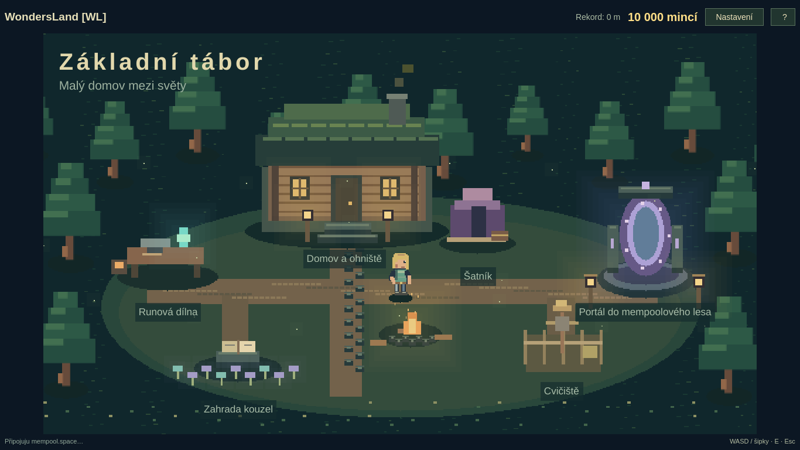

# WondersLand [WL] · 0.3.1

Nativní Qt/QML hra: dojdi k portálu, stiskni E, vyber schopnost a potvrď E.
Každý běh začíná od 0 m. Oblasti jednoho lesa se mění při 500, 1 500, 3 000
a 6 000 m; rozměry skutečných transakcí určuje jediná velikostní křivka.

Primární cílový provoz bude **v prohlížeči na doméně**. Tato revize dokončuje
stávající nativní aplikaci; [rozhodnutí o platformě](docs/BROWSER_TARGET.md)
je uložené pro další vývoj. Web zatím nenasazuje.

Větev: [game/roguelite-0.3](https://github.com/WondrejGrower/WondersLand/tree/game/roguelite-0.3).

| Kde | Ovládání |
| --- | --- |
| Všechny nabídky | WASD nebo šipky, E potvrdit, Esc zpět; funguje i myš |
| Zadávání jména | Písmena jsou text, Enter/Esc ukončí editaci; Tab také funguje |
| Tábor | WASD/šipky nebo kliknutí pro pohyb, E u stanoviště |
| Běh | Mezerník/W/↑/klik pro skok, podržení pro výšku; F pro získaný jetpack |
| Pauza a návrat | P/Esc pauza, B návrat do tábora |
| Nastavení, nápověda, celá obrazovka | F10, ?, F11 |

Nová postava začíná jako Zahradník. Cvičiště se otevře po prvním živém běhu,
další systémy postupně podle celkových živých metrů a nejlepšího běhu.
Statistiky jsou na Cvičišti, výroba v Runové dílně, vybavení a vzhled v Šatníku,
výzkum v Zahradě kouzel. Třídu lze později změnit bez resetu.
Trénink a záznamy neposkytují trvalé odměny. Platby hra neobsahuje.

Nastavení obsahuje English / Čeština a přepíná celé rozhraní za běhu.
Jazyk přežije restart i reset postavy; nová instalace má angličtinu.

## Sestavení a kontroly

Arch/Omarchy: GCC s C++17, make, qmake6, qt6-base, qt6-declarative,
qt6-wayland; Python 3 pro analytické nástroje. Spouštěj z kořene projektu:

```sh
./bin/build
./bin/test
./build/wondersland-game open
./build/wondersland-game check --json
./build/wondersland-game check --live --json
./build/wondersland-game language cs
./bin/install
```

Aplikace se objeví pod WondersLand [WL] v launcheru Super+Space.
Data: `~/.local/share/wondersland-game/` (`progress.json`, `settings.json`,
`last-trace.json`). Migrace starého postupu vytvoří zálohu `.pre-v4`.

```sh
./build/wondersland-game preview /tmp/camp.png --camp --cs --size 1366x768
./build/wondersland-game preview /tmp/training.png --training --progress --cs
./build/wondersland-game preview /tmp/settings.png --settings --cs
python3 tools/record_mempool.py --help
python3 tools/analyze.py docs/live-recent-sample.json --seeds 50
```

[Popis změn a migrace](docs/JOURNEY_UPDATE.md) ·
[Ověření a náhledy](docs/JOURNEY_VERIFICATION.md) ·
[Konfigurace](src/balance.json).

Živý zdroj vrací jen nedávné transakce, nikoliv celý mempool. Velké transakce
mohou být nepřekonatelné; nevzniká povinně bezpečná cesta. Ekonomika a hranice
odemykání jsou pracovní návrh bez dlouhodobého lidského vyvážení. Tvrdý pád
může ztratit posledních několik sekund neuložených odměn.
