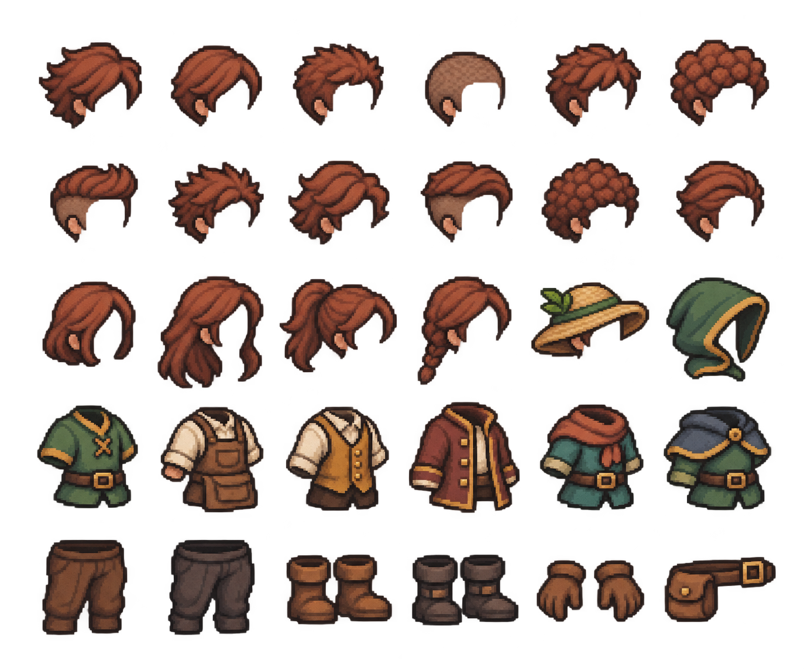

# WondersLand · pixelartové podklady pro postavy

Aktualizace 2026-11-08. [Zadání pro Codex](../../../docs/CHARACTER_INVENTORY_BRIEF.md).

Nová sada obsahuje 12 krátkých či klučičích a 4 delší účesy, 2 pokrývky hlavy,
6 základních oděvů, 2 kalhoty, 2 páry kožených bot, kožené pracovní rukavice
a brašnu. Diamantové boty a rukavice jsou vyřazené ze startovní sady;
jejich vzhled patří do budoucího skinu.

- `starter-customization-v2.png`: nový zdroj s alfa průhledností.
- `character-roster-reference.jpg`: původní proporce a styl 12 postav.
- `forest-camp-reference.jpg`: původní přírodní a táborové motivy.
- `manifest.json`: soupis 30 komponent, výchozí set a kontrolní součty.
- `generation-prompt.txt`: přesné zadání úpravy, vytvořeno vestavěným generátorem obrázků.

Jde o výtvarné zdroje. Před použitím ve hře je třeba připravit oddělené
zarovnané pixelové vrstvy a animace. Vizuální řádky a sloupce nejsou zaručené
souřadnice výřezu. JPG mají bílé pozadí. Statický atlas není implementovaný
inventář ani hotová animovaná sada.
