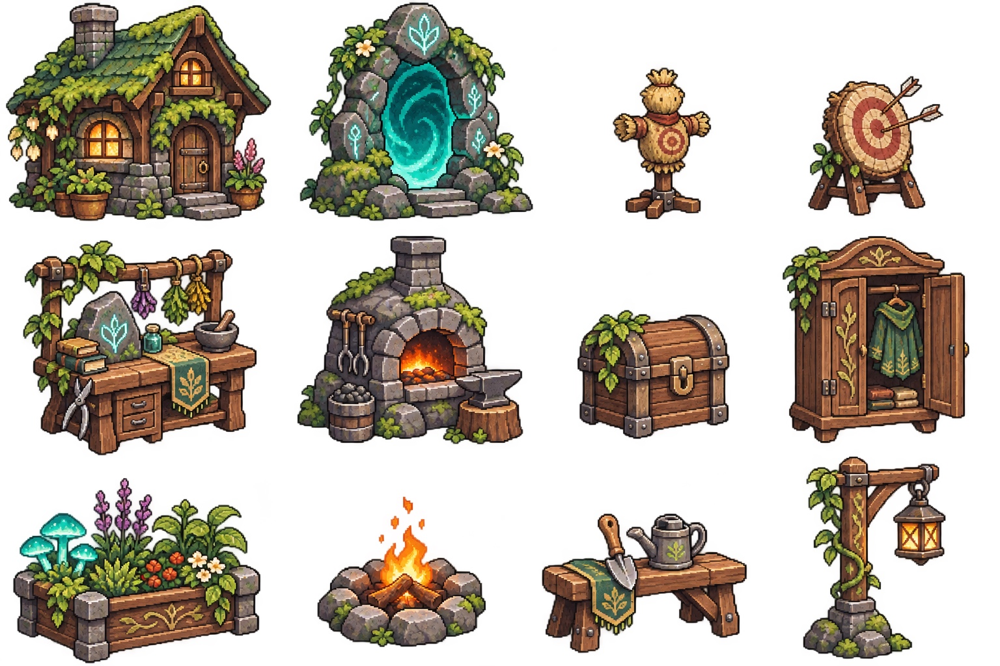
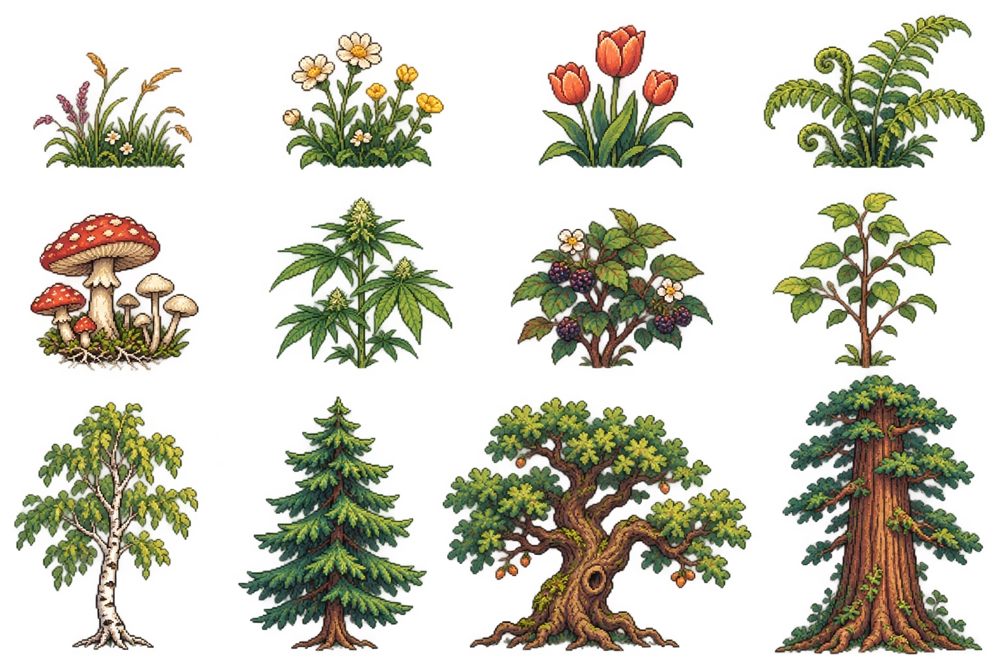

# WondersLand · pixelartové podklady pro postavy

Aktualizace 2026-11-08. [Zadání pro Codex](../../../docs/CHARACTER_INVENTORY_BRIEF.md).

Nová sada obsahuje 12 krátkých či klučičích a 4 delší účesy, 2 pokrývky hlavy,
6 základních oděvů, 2 kalhoty, 2 páry kožených bot, kožené pracovní rukavice
a brašnu. Diamantové boty a rukavice jsou vyřazené ze startovní sady;
jejich vzhled patří do budoucího skinu.

- `starter-customization-v2.png`: nový zdroj s alfa průhledností.
- `character-roster-reference.jpg`: původní proporce a styl 12 postav.
- `forest-camp-reference.jpg`: původní přírodní a táborové motivy.
- `manifest.json`: soupis 30 komponent postavy, 24 motivů prostředí, výchozí set a kontrolní součty.
- `generation-prompt.txt`: přesné zadání úpravy, vytvořeno vestavěným generátorem obrázků.

Jde o výtvarné zdroje. Před použitím ve hře je třeba připravit oddělené
zarovnané pixelové vrstvy a animace. Vizuální řádky a sloupce nejsou zaručené
souřadnice výřezu. JPG mají bílé pozadí. Statický atlas není implementovaný
inventář ani hotová animovaná sada.

## Dodatečné podklady prostředí

Doplněno 8. listopadu 2026. Původní JPG jsou zachovaná beze změny.

| Soubor | Obsah |
| --- | --- |
| [camp-props-reference.jpg](camp-props-reference.jpg) | 12 objektů: domek, portál, cvičný panák, terč, bylinkový stůl, výheň, truhla, šatník, záhon, ohniště, zahradnická lavice a lucerna |
| [botanical-plants-reference.jpg](botanical-plants-reference.jpg) | 12 motivů: luční porost, květy, tulipány, kapradí, houby, konopí, ostružinový keř, mladý stromek, bříza a tři větší stromy |

Oba atlasy mají 4 sloupce × 3 řádky. Vizuální názvy a pozice jednotlivých
motivů jsou v `manifest.json` pod `environmentAtlases`. Názvy popisují
stylizované motivy, nepředstavují botanické určení druhů.

Pro Codex: tyto dva soubory rozšiřují výtvarné zdroje prostředí. Mají bílé
pozadí a nejsou rozřezané produkční sprity; před integrací připrav průhledné
výřezy, ověř pixelovou mřížku, měřítko a pivot. Dodání těchto podkladů samo
nemění funkci stanovišť, překážek, kolize ani velikostní křivku transakcí.
Aktuální produkční vrstvy postavy popisuje [assets/runtime/README.md](../../runtime/README.md).

Integrace prostředí do verze 0.3.3 je popsaná v
[ověření botanického tábora](../../../docs/BOTANICAL_TIME_VERIFICATION.md).
Původní JPG zde zůstávají beze změny; průhledné produkční PNG a prompty
jsou odděleně v assets/runtime.
